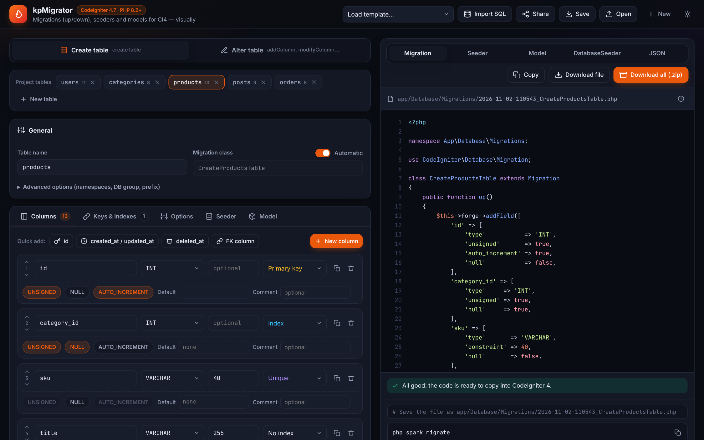
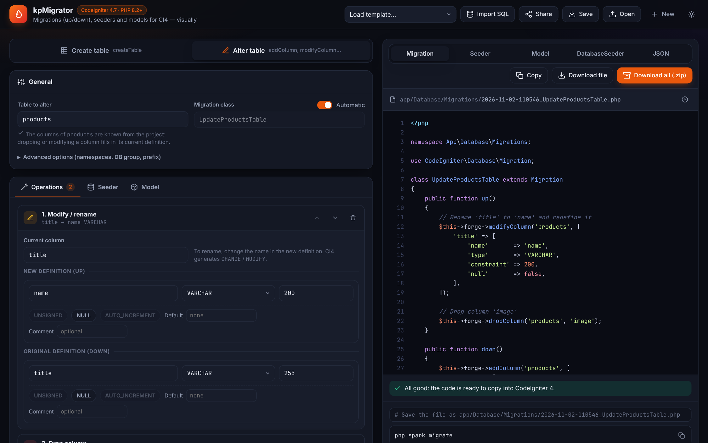
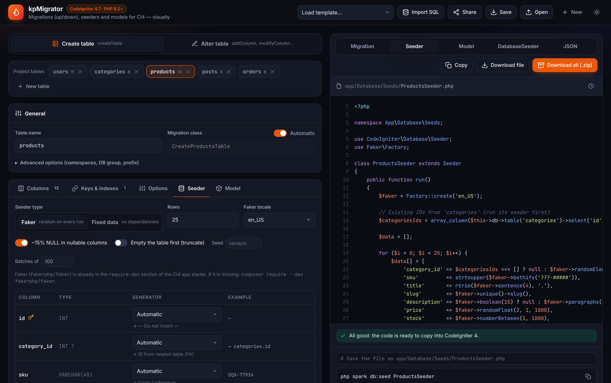
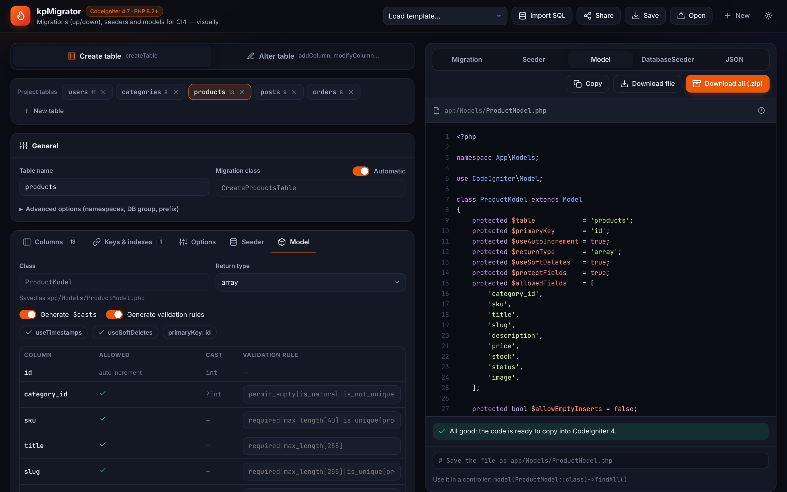

# kpMigrator · CI4 Migration Studio

A visual generator of **migrations** (`up()` / `down()`), **seeders** and **models** for **CodeIgniter 4.7+** (PHP 8.2+).
Design your tables in the browser and get ready-to-use PHP files — no install, no build, nothing sent to a server.



## How it works

1. **Open `index.html`** in any modern browser. It starts with an empty project.
2. **Design your tables** in *Create table*: add columns, keys, indexes and foreign keys. You can add several tables to the same project, load a template or import existing tables with **Import SQL** (paste the output of `SHOW CREATE TABLE`).
3. **Alter existing tables** in *Alter table*: add operations (add, drop, modify or rename columns, indexes, foreign keys…). The `down()` method is generated automatically in reverse order.
4. **Check the result** on the right panel: Migration, Seeder, Model, DatabaseSeeder or JSON. Errors and warnings are shown below the code.
5. **Copy or download** a single file, or **Download all (.zip)** and extract it into the root of your CodeIgniter project. Then run:

```bash
php spark migrate
```

```bash
php spark db:seed DatabaseSeeder
```

Your work is saved automatically in the browser. Use **Save** / **Open** to keep a project as JSON, or **Share** to copy a link that contains the whole project.

## Features

| | |
|---|---|
| **Create migrations** | All common MySQL types, `UNSIGNED`, `NULL`, `AUTO_INCREMENT`, defaults (including `CURRENT_TIMESTAMP`), comments, primary / unique / composite indexes, foreign keys, engine and table comment. |
| **Alter migrations** | `addColumn`, `dropColumn`, `modifyColumn` (rename), indexes, foreign keys, `renameTable` and custom SQL, each with its automatic rollback. |
| **Multi-table projects** | Migrations are numbered so that referenced tables are created first. |
| **Seeders** | Proposed from the table structure: Faker (random on every run) or fixed random data with no dependencies. Foreign keys use real IDs from the related table. Every column's generator can be changed. |
| **DatabaseSeeder** | Calls every seeder in foreign-key order. |
| **Models** | `$allowedFields`, timestamps, soft deletes, `$casts` and validation rules (`required`, `max_length`, `valid_email`, `in_list`, `is_unique`, `is_not_unique`…), editable per column. |
| **Import SQL** | Turns `CREATE TABLE` statements into editable tables. |
| **Validation** | Detects problems before running them, e.g. `SET NULL` on a NOT NULL column or foreign key type mismatches. |

| Alter table | Seeder | Model |
|---|---|---|
|  |  |  |

## Documentation

See the **[User guide](docs/USER_GUIDE.md)** for a walkthrough of every screen.

## Requirements of the generated code

- CodeIgniter **4.7** or later, PHP **8.2** or later.
- Designed for **MySQL / MariaDB** (`after`, `first`, engine and comments only apply there).
- Faker seeders need `fakerphp/faker`, already included in the `require-dev` section of the CodeIgniter app starter (`composer require --dev fakerphp/faker` otherwise).
