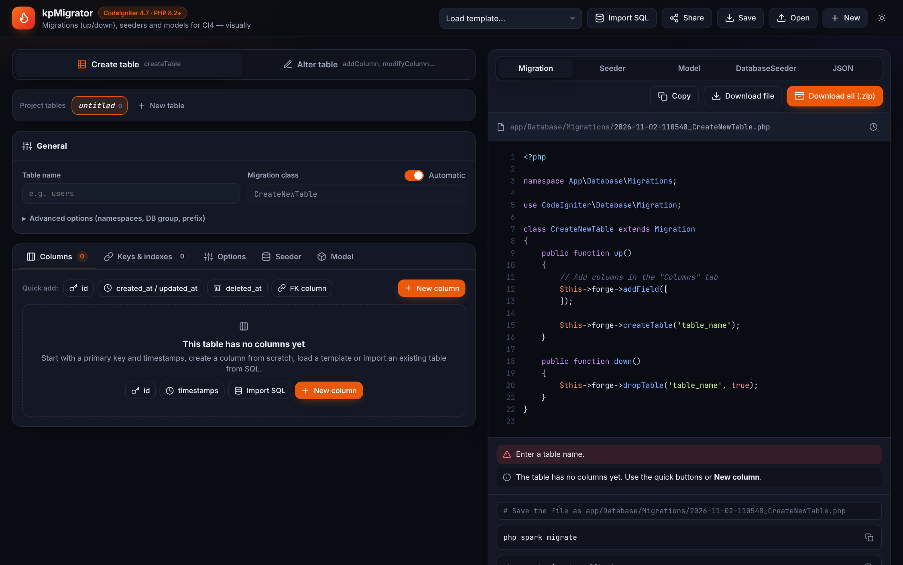
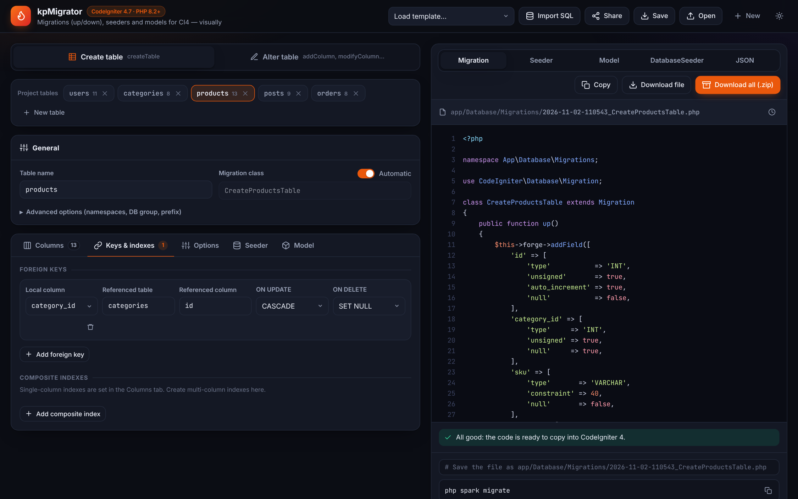
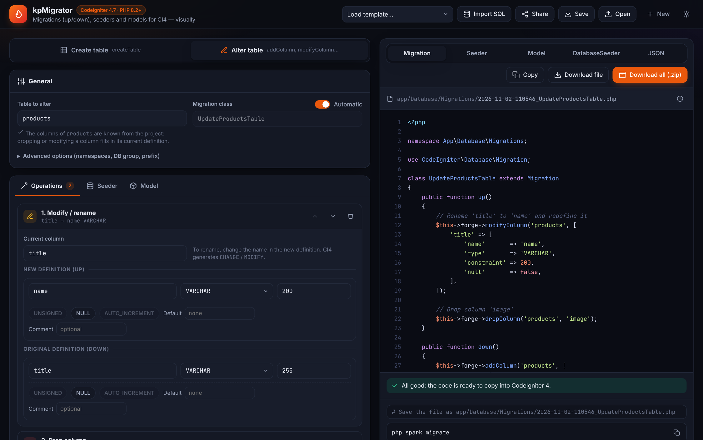
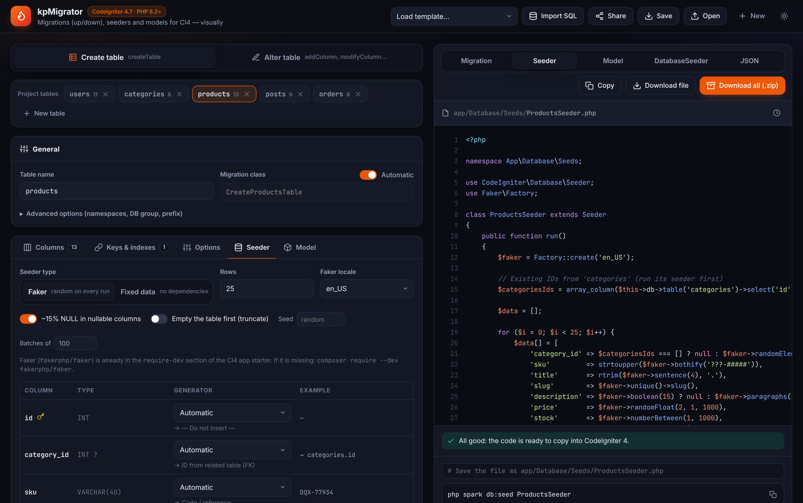
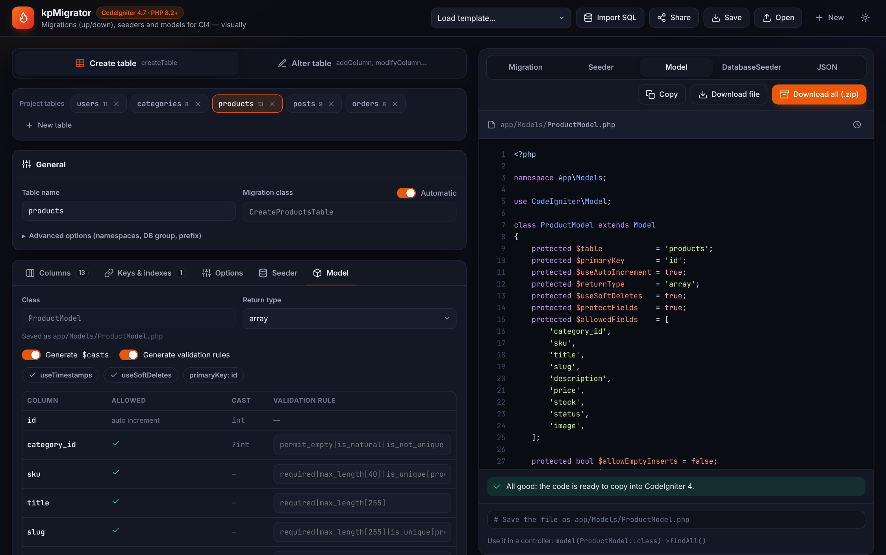
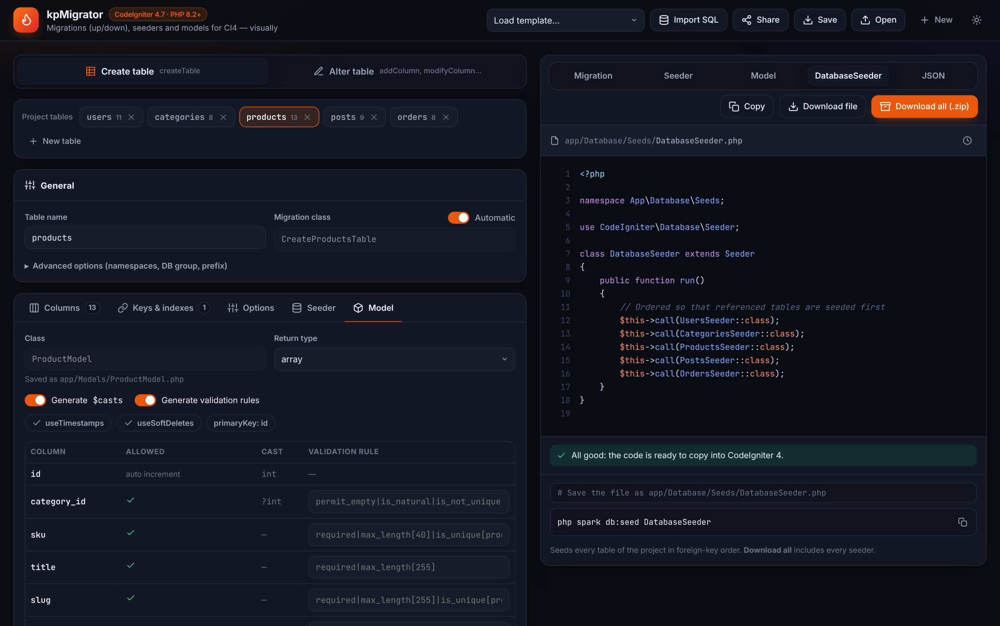
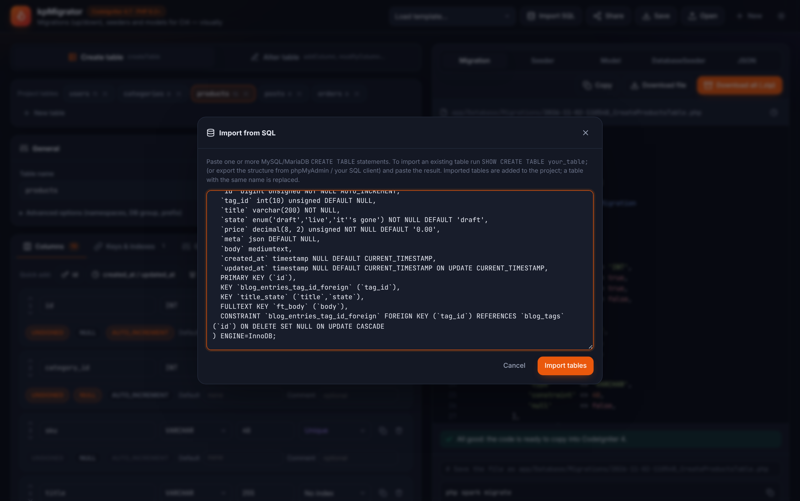
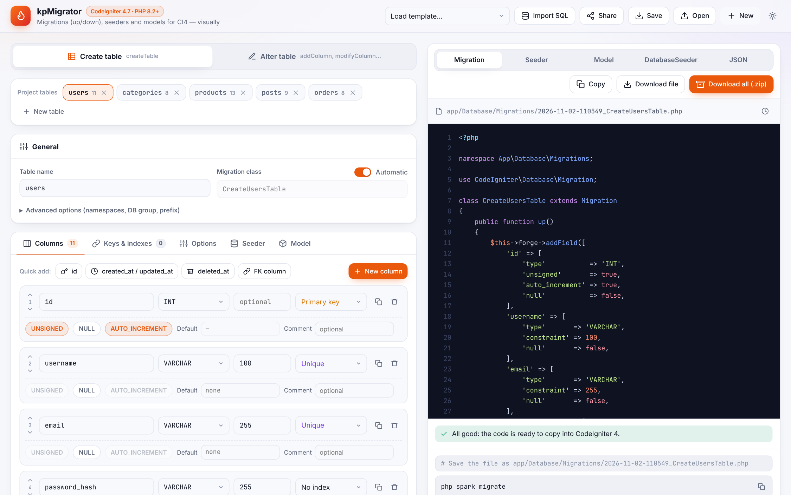
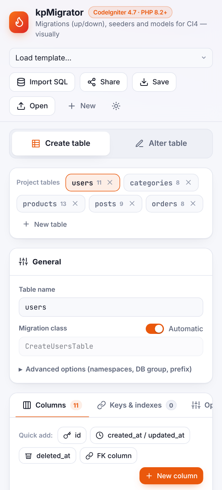

# kpMigrator · User guide

kpMigrator generates CodeIgniter 4.7+ migrations, seeders and models from a visual editor.
The screen has two halves: the **editor** on the left and the **generated code** on the right.

- [The header](#the-header)
- [Create table](#create-table)
- [Alter table](#alter-table)
- [Seeder](#seeder)
- [Model](#model)
- [Generated code panel](#generated-code-panel)
- [Import SQL](#import-sql)
- [Tips](#tips)

---

## The header

| Button | What it does |
|---|---|
| **Load template…** | Adds a sample table (users, products…), loads a 5-table example project, or loads an alter-table example. |
| **Import SQL** | Creates tables from `CREATE TABLE` statements ([details](#import-sql)). |
| **Share** | Copies a link that contains the whole project. Whoever opens it gets the same project. |
| **Save / Open** | Saves the project as a JSON file and opens it again later. Files from the previous *CI4 Migration & Seeder Studio* can also be opened. |
| **New** | Starts a new, empty project. |
| ☀ | Switches between light and dark theme. |

The project is also saved automatically in your browser, so closing the tab does not lose your work.

---

## Create table

Choose **Create table** at the top of the editor.

### Project tables

A project can contain several tables. Use the chips to switch between them, **+ New table** to add one and **×** to remove one.
Migrations are numbered so that tables referenced by foreign keys are created first.

### General

- **Table name** — used in `createTable()` / `dropTable()`.
- **Migration class** — generated automatically (`CreateUsersTable`). Turn off *Automatic* to type your own.
- **Advanced options** — namespaces, `$DBGroup` and the `DBPrefix` of your database configuration.

### Columns

Each column has a name, type, length (or list of values for `ENUM` / `SET`, or precision for `DECIMAL`) and an index type: *Primary key*, *Unique* or *Index*.
Below, toggle `UNSIGNED`, `NULL` and `AUTO_INCREMENT`, and set a **default** (`NULL`, `CURRENT_TIMESTAMP`, `CURRENT_TIMESTAMP ON UPDATE CURRENT_TIMESTAMP` or any value) and a **comment**.

**Quick add** creates the usual columns in one click: `id`, `created_at` / `updated_at`, `deleted_at`, or a foreign key column with its relation.

### Keys & indexes

- **Foreign keys** — local column, referenced table and column, `ON UPDATE` and `ON DELETE`.
- **Composite indexes** — indexes over several columns, optionally unique and with a custom name.

### Options

`IF NOT EXISTS` for `createTable()`, `IF EXISTS` for `dropTable()`, MySQL engine and table comment.

---

## Alter table

Choose **Alter table**, type the table to change and add operations from the **Add operation** menu:

| Operation | up() | down() |
|---|---|---|
| Add column | `addColumn()` (+ index if selected) | `dropColumn()` |
| Drop column | `dropColumn()` | `addColumn()` with the original definition |
| Modify / rename | `modifyColumn()` with the new definition | `modifyColumn()` with the original definition |
| Add / drop index | `addKey()` + `processIndexes()` / `dropKey()` | the opposite |
| Add / drop foreign key | `addForeignKey()` + `processIndexes()` / `dropForeignKey()` | the opposite |
| Rename table | `renameTable()` | `renameTable()` back |
| Custom SQL | your SQL | your rollback SQL |

Operations run in order (use the arrows to reorder them) and `down()` undoes them in reverse order, so `php spark migrate:rollback` always restores the previous state.

> **Tip:** if the table you alter also exists in the project (for instance, imported with **Import SQL**), its columns are suggested automatically and dropping or modifying a column fills in its current definition for you.

---

## Seeder

The **Seeder** tab proposes test data for the selected table.

- **Faker** — generates PHP that uses [Faker](https://fakerphp.org/), so every run produces different data. Choose the locale and, optionally, a seed to get repeatable data.
- **Fixed data** — writes the random data directly into the seeder as a PHP array. No dependencies. Press **Regenerate data** for a new set.

For each column, **Automatic** picks a generator from the column name and type (email, name, phone, slug, price, the values of an `ENUM`…). You can choose another generator, set a min–max range for numbers, or write your own PHP expression.

Other options: number of rows, about 15 % of `NULL` values in nullable columns, emptying the table first (truncate) and insert batch size.

Foreign key columns use IDs that already exist in the referenced table, so seed referenced tables first — the **DatabaseSeeder** does it in the right order.

---

## Model

The **Model** tab configures the CodeIgniter model of the table (`app/Models/ProductModel.php`):

- `$allowedFields` — every column except the auto-increment key and the date columns managed by the model.
- `$useTimestamps` / `$useSoftDeletes` — enabled automatically when the table has `created_at` / `updated_at` / `deleted_at`.
- `$casts` — `int`, `boolean` and `json-array` casts (optional).
- `$validationRules` — suggested from the column definition (`required`, `max_length`, `valid_email`, `in_list`, `is_unique`, `is_not_unique` for foreign keys…). Type in a rule to replace the suggestion.

---

## Generated code panel

Choose what to see: **Migration**, **Seeder**, **Model**, **DatabaseSeeder** or **JSON**.

- **Copy** copies the code, **Download file** downloads it with the right file name.
- **Download all (.zip)** downloads the whole project: one migration per table (in foreign-key order), the alter migration if any, every seeder, the `DatabaseSeeder`, every model and the project JSON. Extract it into the root of your CodeIgniter project.
- The clock icon next to the file name sets a new timestamp for the migration file name.
- Below the code you will find **validation messages** and the **spark commands** to run.

---

## Import SQL

Paste one or more MySQL / MariaDB `CREATE TABLE` statements: the output of `SHOW CREATE TABLE your_table;`, or the structure exported from phpMyAdmin, Adminer, HeidiSQL, DBeaver…

Columns, types, defaults, comments, primary keys, unique keys, indexes, foreign keys, engine and table comment are imported. `FULLTEXT` / `SPATIAL` indexes and `CHECK` constraints are skipped (a warning is written to the browser console).

---

## Tips

- **Foreign keys** must have exactly the same type as the referenced column (usually `INT UNSIGNED`). kpMigrator warns you when the referenced table is in the project and the types differ.
- **`SET NULL`** actions require the column to be nullable.
- **Class names** of migrations must be unique in your project. When in doubt, turn off *Automatic* and choose a descriptive name.
- To start from an existing database, import its tables with **Import SQL**, then use **Alter table** for the changes.

The interface also works on tablets and phones, in light and dark themes:

| Light theme | Mobile |
|---|---|
|  |  |
